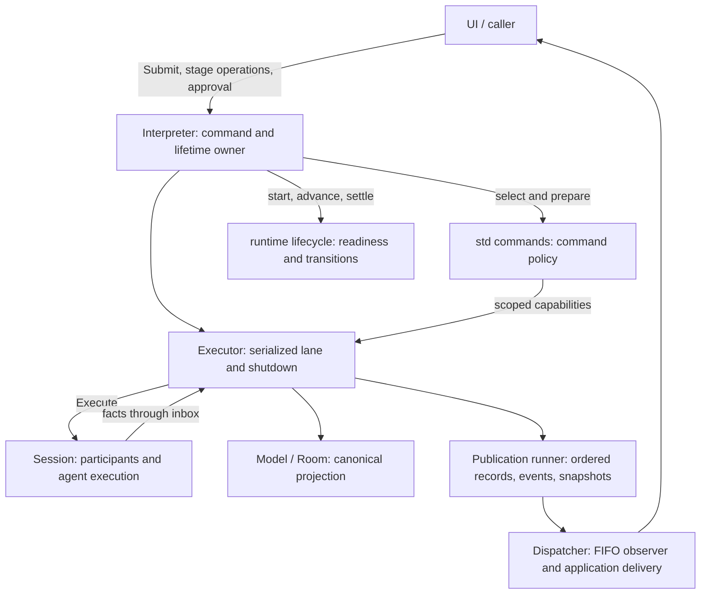
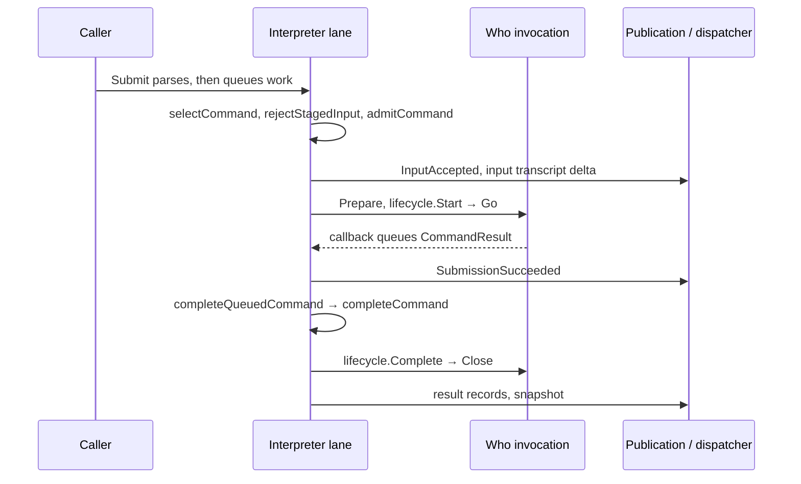
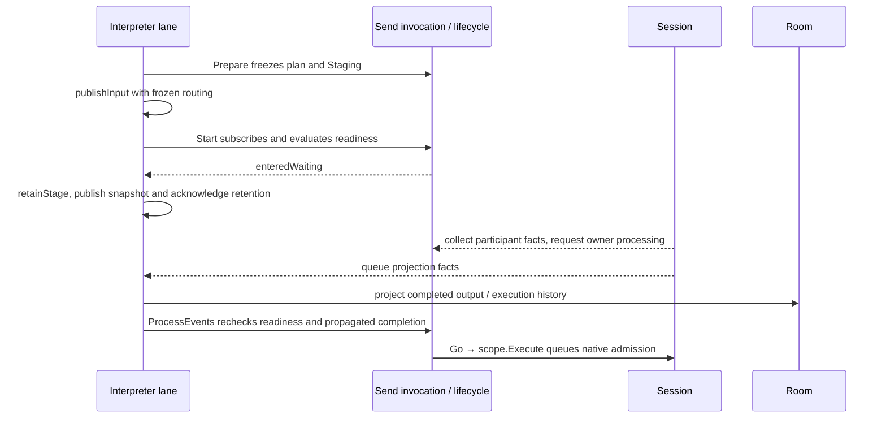

# Interpreter architecture: ownership and execution

Status: open; interpreter migration paused on 2026-10-18.

This records the implementation reviewed during the uncommitted monolith-removal
work. That work was reverted when this note was parked. The descriptions and
traces below are a historical review snapshot, not the current repository layout
or an approved target architecture. Code links point to retained owners where
possible; recheck them and the traces before resuming.

This describes the reviewed implementation after the proposed monolith package removal.
It is a map for understanding and reviewing the code, not a declaration that every
existing abstraction should survive. “Required” describes behavior to preserve;
“Candidate” describes a possible change that has not been implemented or approved.

## 1. Owners and boundaries

The interpreter turns parsed input into command invocations, manages their
lifetimes, projects Session facts into canonical room state, and publishes results.
One executor lane serializes these decisions. Observer delivery has a separate
FIFO queue and goroutine; shell work and participant work run asynchronously.



These are responsibility boundaries, not separate services. The model, executor,
publication runner and submission adapters are private objects in the same package.

| Owner | Owns | Does not own |
|---|---|---|
| Interpreter | Registry selection, pending invocation identity, visible stage, submission acknowledgement and terminal-event policy | Participant execution or command-specific delivery construction |
| Command / invocation (`std`) | Validation, frozen delivery plans, command work, output formatting; loops coordinate their children | Global stage retention, canonical room state or observer delivery |
| Lifecycle (`runtime`) | Prepared/waiting/running/finished transitions, readiness, subscription cleanup, accepting one result | UI acknowledgements, Session scheduling or publication |
| Executor | Serialized operations, native Session admission, workers, event ingestion and shutdown coordination | Individual command workflows |
| Model / Room | Canonical records, participant-output projection, approval projection and completed-turn history | Live participant availability or invocation execution |
| Publication runner / dispatcher | Applying publication batches and delivering them in order | Deciding whether a command succeeded |
| Session | Participant identity, startup, availability, agent execution, cancellation and routing facts | Interpreter staging, transcript presentation or UI state |
| UI | Composer, focus, rendering, UI-owned application actions | Interpreter lifecycle or Session mutation policy |

Start at [construction](../../../internal/interpreter/api.go),
[input admission](../../../internal/interpreter/api_requests.go) and
[command orchestration](../../../internal/interpreter/command_lifecycle.go).

## 2. Where state may change

After construction, the executor lane owns the pending invocation map, stage,
lifecycle transitions, model, canonical Room and publication-runner operations.
`Prepare`, `Go`, `ProcessEvents`, settlement and publication run on that lane.
`Go` initiates work; it must not wait for asynchronous participant work to finish.

A command's completion callback transfers a result to a buffered channel and
requests owner work. It does not settle the lifecycle. Participant subscriptions
collect synchronized facts and request processing; the lane evaluates those facts.
Synchronous callbacks follow the same rule. The owner explicitly consumes an
already-queued result after Start or event processing, before another input runs.

The dispatcher invokes observers and application callbacks on its own goroutine.
Slow observers delay delivery and shutdown flushing, but do not block ordinary
execution-lane progress. Application results return through the completion path.
Public methods that wait for the lane (`Snapshot`, stage operations, `Close`, named
resolution) must not be called from work already running on that lane. Ordered
observer/application callbacks must return promptly rather than wait for shutdown.

Cross-goroutine state is deliberately narrower than lane-owned state:

| State | Synchronization / lifetime |
|---|---|
| Operation queue and Session-event inbox | Thread-safe queue; inbox mutex coalesces drain wakeups without dropping facts |
| Admission gate, native-delivery intake, shutdown completion intake | Executor `enqueueMu`; completion intake outlives input admission |
| Execution scopes and provider publication buffers | Scope/provider mutexes; callbacks may race close |
| Lifecycle participant facts | Subscription synchronization; lifecycle transitions remain on the lane |
| Detached snapshot cache | Cache mutex and cloning; available after admission closes |
| Shell workers | Executor context and wait group; results return through completion intake |
| Dispatcher queue | FIFO queue, flush barrier, joined close; observers installed before startup |

See [executor](../../../internal/interpreter/monolith/executor.go),
[participant collection](../../../internal/interpreter/runtime/participant_subscription.go),
[Session scopes](../../../internal/interpreter/monolith/command_session.go) and
[dispatcher](../../../internal/interpreter/monolith/event_dispatcher.go).

## 3. Four concrete traces

### Ordinary command: `/who`



`WhoCommand.Prepare` captures participant names from the invocation's detached
view. Its `Go` completes synchronously. The pending identity is installed before
Start, so that callback cannot bypass ownership. Submission acknowledgement here
means the invocation was started, not that all output has already been published.

### Waiting addressed send: `@ada fix the test`



Readiness requires idle, startup-ready participants and propagation of their last
completed execution into canonical Room history. A participant callback alone
cannot launch the command. Required departure fails waiting work; optional
recipient departure shrinks the frozen plan; later joins do not expand it.

The interpreter retains one visible stage and rejects competing input before
reporting parse/preparation errors. Registered application actions are an explicit
exception. Edit/discard succeeds only while the lifecycle can atomically discard
still-blocked work. Interrupt requests cancellation and continues waiting for real
readiness; successful cancellation is not readiness.

See [send preparation](../../../internal/interpreter/std/command_send.go),
[lifecycle readiness](../../../internal/interpreter/runtime/invocation_lifecycle.go)
and [stage operations](../../../internal/interpreter/stage_operations.go).

### Send completion and causal publication

```mermaid
sequenceDiagram
    participant Lane as Executor lane
    participant Session
    participant Scope as Execution scope / provider
    participant Owner as Interpreter lifecycle owner
    participant Pub as Publication runner
    Lane->>Session: nativeDeliveryOperation → Execute(command)
    Session-->>Lane: execution ID, error, buffered causal facts
    Lane->>Scope: ExecutionCompleted (or protocol failure)
    Scope->>Scope: command callback collects result; retain completion work
    Lane->>Scope: publishDelivery
    Scope->>Owner: run retained work → completeCommand
    Owner->>Owner: accept result, close lifecycle, remove pending identity
    Owner-->>Scope: buffer records before facts; outcomes after facts
    Scope->>Pub: records → Session projection → terminal events / snapshots
```

`scheduledOperation.apply` drains admitted native work before the next scheduled
turn can inspect readiness. Each execution scope receives only its own outcome;
there is no recipient-based correlation. ExecutionCompleted means Session.Execute
returned. It does **not** mean an agent finished its asynchronous turn. Missing
routing is valid for ordinary execution; Delivery rejects it, while individual
commands validate routing kind, recipient and role. Malformed/multiple routing
outcomes are protocol failures.

Settlement occurs before causal publication so command-produced input records can
precede Session facts. The provider buffers publication while dispatching; the
runner then applies one ordered batch. Room completion facts queue later readiness
attention rather than reentering command execution from a Room observer.

A direct send acknowledges after delivery. A retained send has already acknowledged
retention: later failure is an OperationFailed, not another submission result.
Partial delivery retains actual routing and records. Late/duplicate completion
cannot publish after its pending identity is removed.

See [scope dispatch](../../../internal/interpreter/monolith/command_session.go),
[causal buffering](../../../internal/interpreter/monolith/command_session_provider.go),
[result policy](../../../internal/interpreter/command_publication.go) and
[publication runner](../../../internal/interpreter/monolith/instruction_runner.go).

### Shutdown

```mermaid
sequenceDiagram
    participant Caller
    participant Lane as Executor lane
    participant Workers as Session / shell workers
    participant Dispatcher
    participant Owner as Interpreter lifecycle owner
    Caller->>Lane: requestClose closes admission, queues shutdown
    Lane->>Lane: finish operations accepted before shutdown
    Lane->>Workers: Session.Shutdown; cancel shell context; wait workers
    Lane->>Dispatcher: Flush prior events and application callbacks
    Lane->>Lane: close completion intake, drain retained completions
    Lane->>Owner: closeInvocations in invocation-ID order
    Lane->>Lane: close operation queue, refresh snapshot, close Room
    Lane->>Dispatcher: Close flushes remaining publications and joins
    Lane-->>Caller: close done; Close returns
```

Input admission closes before completion intake. Results arriving during draining
are retained instead of lost. Remaining waiting/running lifecycles then close once,
revoking their scopes. Parent-context cancellation requests the same shutdown
operation. `Close` waits for observer delivery; a blocked observer can delay it.

## 4. Required guarantees and evidence

Preserve these behaviors when simplifying; the existing layers are not themselves
requirements.

| Guarantee | Regression evidence |
|---|---|
| Acceptance precedes its input transcript delta; causal updates precede completion | [transcript tests](../../../internal/interpreter/transcript_test.go) |
| Synchronous callbacks cannot overtake start/acknowledgement or settle twice | [lifecycle tests](../../../internal/interpreter/command_lifecycle_test.go), [runtime tests](../../../internal/interpreter/runtime/invocation_lifecycle_test.go) |
| Readiness includes startup and canonical completion propagation | [startup tests](../../../internal/interpreter/startup_window_test.go), [readiness tests](../../../internal/interpreter/runtime/invocation_readiness_test.go) |
| Scoped results remain isolated, including identical recipients and close races | [scope tests](../../../internal/interpreter/monolith/command_delivery_scope_test.go), [provider tests](../../../internal/interpreter/monolith/command_session_provider_test.go) |
| Stage removal and interrupt cannot launch stale work | [stage tests](../../../internal/interpreter/stage_test.go), [recipient tests](../../../internal/interpreter/stage_recipients_test.go) |
| Slow observers do not block ordinary lane progress; shutdown flushes accepted outcomes | [dispatcher tests](../../../internal/interpreter/monolith/event_dispatch_test.go), [shutdown publication test](../../../internal/interpreter/publication_shutdown_test.go) |

These tests are evidence, not a complete proof. Keep the traces current when a
behavior changes; run focused regressions and race checks for concurrency changes.

## 5. Boundaries to simplify, not merely relocate

| Current boundary | Reason it exists | Candidate and constraint |
|---|---|---|
| Interpreter / executor | Command ownership versus queue, worker and shutdown ownership | Keep one lane; make cross-owner calls explicit. Do not create another scheduler. |
| Model and model-port interfaces | Canonical projection separated from execution effects | Check actual substitutes and test consumers; remove interfaces that only obscure one concrete owner. |
| Instructions, runner items, runner | Batch records/facts/events while controlling transcript flush and snapshot timing | First express the required batch ordering, then assess a smaller publication API. Preserve acceptance and causal ordering. |
| Submission, invocation publication, Session provider | Source/capability lifetime, result policy and causal buffering | Trace redundant forwarding and ownership overlap; reduce layers without moving lifecycle settlement into an adapter. |
| Executor completion and shutdown intake | Accept worker results after input admission closes | Clarify the two intake lifetimes before changing queues or locks. |

The coordinator still switches on command types: delivery classification,
definition/named-command acknowledgement, loop exclusivity, application-action
stage exemption and some error presentation. Therefore the implementation does
not yet meet an unrestricted “new commands need no central branches” claim.
Document each policy before deciding whether it should become shared metadata,
move into a command, or remain explicit application policy. Do not introduce a
new capability solely to eliminate a switch.

Review one boundary at a time against the traces above. A new package or renamed
file is not evidence that coupling has decreased. Migration movement is complete;
structural acceptance remains open.

## 6. Adding a command without growing the coordinator

For an ordinary command using existing capabilities: implement Command metadata,
Statement and Prepare; return an independent Invocation with Staging, Go and
idempotent Close; register it in construction. Help then follows automatically.
Add parser syntax only if the existing language cannot represent the command.
Verify observable success/failure and any resource lifetime, using a fake for the
capability boundary rather than recreating the whole interpreter.

Return records/results instead of mutating Room. Asynchronous callbacks collect
results and request owner attention; intermediate publication happens from Go or
lane-driven event processing. Use existing scoped Session execution for Session
work, and Delivery only when actual routing is required.

If a command needs a new acknowledgement milestone, global admission rule,
readiness prerequisite, ordering guarantee or shutdown lifetime, that is an
architecture change. Describe its owner and execution trace before extending the
coordinator or runtime contracts. The ordinary-command recipe is not a promise
that all future workflows fit today's API.


## 7. Review feedback — tim, 2026-10-18

The document is a useful implementation map, but the architecture described still
carries substantial monolith complexity. Removing the package completes relocation;
it does not establish that ownership and control flow have become simpler. Treat
this as a refactoring starting point, not architectural approval.

### Foundations to preserve

- One lane owns lifecycle transitions and mutable room state.
- Session owns participant execution and availability.
- Callbacks transfer facts instead of advancing workflows themselves.
- Execution scopes isolate results without recipient-based correlation.
- Input admission and completion intake have different shutdown lifetimes.

These boundaries address real concurrency problems. Preserve their guarantees
while questioning the machinery used to implement them.

### Structural concerns

1. **Execution and publication remain circularly coupled.** The provider runs
   retained interpreter settlement work, which publishes back into that provider,
   which buffers output around Session facts. The interpreter nominally owns
   settlement, but the provider controls when it runs. Following one completion
   requires traversing several objects in both directions. Extending execution or
   intermediate publication consequently requires understanding the whole protocol.
   Input records must precede causal facts; that requirement does not establish
   that this callback-and-buffer arrangement is necessary.

2. **Presentation records secretly carry control information.** `completeCommand`
   examines returned transcript records to infer staged dispatch. The shell
   launcher's `completionEvent` examines records and a cached shell result to
   reconstruct a semantic completion event. Changing output representation can
   therefore change lifecycle-facing events. This weakens the separation between
   command formatting and orchestration and should be explicit architectural debt.

3. **Command policy is distributed across the coordinator.** Acceptance timing,
   acknowledgement timing, final error handling and stage behavior are decided in
   different functions. `publishFinal`, for example, translates failure into events
   and clears `result.Err` to prevent another layer from reporting it again. One
   outcome has several representations coordinated by convention. Some global
   policies belong centrally; each command's policy should still be understandable
   without reconstructing it from several functions. Do not add generic metadata
   merely to hide the existing switches.

4. **Publication retains an interpreter inside the interpreter.** Instructions are
   wrapped as runner items, interpreted by switches and sometimes expanded into
   further instructions. Special cases control transcript flushing and snapshots.
   This mechanism previously supported workflow execution; its remaining vocabulary
   mostly describes publication. Assess whether an explicit ordered batch can
   preserve the guarantees with fewer representations and less indirection.

5. **The simplification plan lacks structural acceptance conditions.** Checking,
   assessing and tracing boundaries are useful activities, but provide no endpoint.
   Each layer can survive indefinitely because it participates in preserving an
   ordering guarantee. Before implementation, decide who interprets terminal
   outcomes, who constructs publication batches, and which forwarding layers will
   disappear. Any temporary bridge needs a defined boundary and removal condition.

### Suggested order when resuming

First make completion and publication flow in one direction, with explicit owners.
Then remove semantic inference from transcript records. Next simplify the
publication instruction machinery and remaining model interfaces. Deleting small
interfaces first may reduce code without resolving the hardest coupling.

Write a concrete proposed execution trace before changing code. Judge it by
whether a reader can follow admission, waiting, execution, success, failure,
cancellation and shutdown through explicit ownership, and whether maintaining one
outcome requires fewer synchronized representations. Preserve the behavior
regressions listed above; passing tests alone does not establish structural quality.

This feedback came from reviewing the document and tracing current ownership
paths during the proposed removal. It did not establish a new runtime regression,
and tests were not rerun for that architectural assessment.
